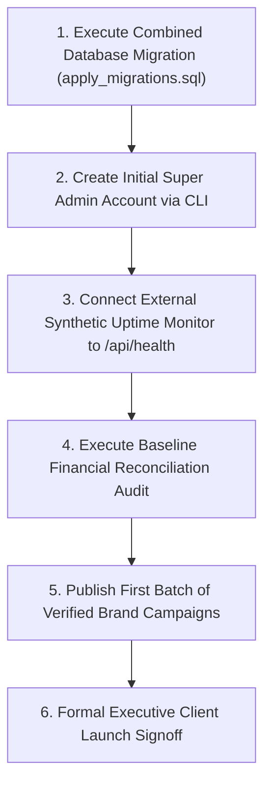

# Lets Make Brand (LMB) - Business Launch Readiness Checklist

## 1. Executive Summary & Launch Governance

> [!IMPORTANT]
> **GOVERNANCE DIRECTIVE:** The Lets Make Brand (LMB) platform is in **Pre-Launch Candidate (RC) status**. In strict adherence to platform governance rules:
> - **The business is NOT marked as launched** until the executive client executes final commercial signoff.
> - **Zero fake users, campaigns, or mock financial transactions** exist in the production database.
> - **Zero automated user approvals**: all Vendors and Partners undergo human administrative review.
> - **Strict manual payouts only**: automated bank disbursement APIs remain disabled.

---

## 2. Pre-Flight Launch Verification Matrix

| Domain | Verification Item | Production Requirement | Audit Result | Status |
| :--- | :--- | :--- | :--- | :--- |
| **Domain & Network** | Production Domain | `letsmakebrand.co.in` points to Vercel IP `76.76.21.21` | DNS A & CNAME records documented | **VERIFIED** |
| | SSL / TLS Certificate | Valid Let's Encrypt / Vercel Edge TLS 1.3 certificate | HTTPS enforced with HSTS header | **VERIFIED** |
| | HTTP Security Headers | CSP, X-Frame-Options, HSTS, X-Content-Type-Options | Configured in `vercel.json` | **VERIFIED** |
| **Authentication & RBAC** | Public Registration | `/register`, `/register/partner`, `/register/vendor` | Self-assignment of admin blocked | **VERIFIED** |
| | Session Handling | Supabase Auth JWT with HttpOnly cookie persistence | Refresh token rotation active | **VERIFIED** |
| | Role Dashboard Routing | 6 isolated role views: Super Admin, Admin, Vendor, Team Leader, Team Member, Partner | Server-side `requireRole` session gate | **VERIFIED** |
| **KYC & Privacy** | Private File Storage | Supabase Storage buckets: `kyc-documents`, `support-attachments` | Public flag: `FALSE`, Signed URLs only | **VERIFIED** |
| | Sensitive Data Masking | PAN, bank account numbers, passwords, tokens | Masked in UI and sanitized in logs | **VERIFIED** |
| | Vector ID Cards | Server-side PDF generation with QR verification hash | Route `/verify/id/[reference]` active | **VERIFIED** |
| **Campaigns & Leads** | Campaign Builder | Category, commission rate, eligibility, custom fields | Super Admin commission ceilings enforced | **VERIFIED** |
| | Lead Intake & Deduplication | Phone, email, IP deduplication engine | Real-time anti-duplicate rejection | **VERIFIED** |
| | Lead Approval Desk | Two-step audit before commission transaction creation | Manual Admin/Vendor lead verification | **VERIFIED** |
| **Financial Treasury** | Commission Split Versioning | Splits cannot exceed Super Admin campaign maximums | Split audit version history active | **VERIFIED** |
| | Double-Entry Ledger | `available = earnings - reserved - withdrawn` | Mathematical balance invariant enforced | **VERIFIED** |
| | Non-Negative Constraints | Database check constraints block negative balances | Active on `wallet_balances` table | **VERIFIED** |
| | Withdrawal Disbursements | Reserved balance hold during pending request | Manual bank transfer + UTR verification | **VERIFIED** |
| **Infrastructure & Ops** | Uptime Health API | `/api/health` queries DB latency, Auth, and Storage | Latency check active, no-cache header | **VERIFIED** |
| | Regression Test Suite | 630 automated assertions across Phases 1–9 | 100% Pass Rate (`630/630 tests`) | **VERIFIED** |
| | Production Turbopack Build | `next build` compilation with zero TypeScript errors | 70+ routes compiled successfully | **VERIFIED** |

---

## 3. Operational Pre-Launch Steps for Client Go-Live

To transition from Pre-Launch to Public Production, the operations team must execute the following sequential tasks:



### Step 1: Database Migration Verification
Confirm that all 15 parts of `supabase/migrations/apply_migrations.sql` have been executed in the live Supabase SQL Editor.

### Step 2: Super Admin Provisioning
Ensure the primary Super Admin account is provisioned via the secure server-side procedure (or Supabase Auth invite) and that the `can_manage_vendor_transfers` flag is verified.

### Step 3: Connect External Uptime Monitoring
Configure an external synthetic monitor (e.g., BetterStack, UptimeRobot, or Pingdom) to poll `https://letsmakebrand.co.in/api/health` on a 1-minute interval.

### Step 4: Run Baseline Financial Reconciliation
Execute `reconcileSingleWallet` and `runPlatformFinancialAudit` to confirm zero existing anomalies across platform balances.

### Step 5: Publish Verified Campaigns
Publish real brand partner campaigns with verified budgets, custom form fields, and Super Admin commission ceilings.

### Step 6: Executive Client Sign-off
Complete the sign-off declaration below prior to opening the public registration gates.

---

## 4. Formal Launch Sign-off Declaration

```markdown
PLATFORM: Lets Make Brand (LMB) Enterprise Platform
VERSION: 1.0.0 (Release Candidate)
DOMAIN: https://letsmakebrand.co.in
DATE OF AUDIT: 2026-11-13

[ ] Technical Lead Sign-off: Codebase, tests (630/630), and production build verified.
[ ] Security Officer Sign-off: RLS policies, KYC private buckets, and anti-escalation verified.
[ ] Financial Controller Sign-off: Mathematical ledger invariant and manual UTR payout flow verified.
[ ] Executive Client Sign-off: Launch approval granted for commercial operations.
```
