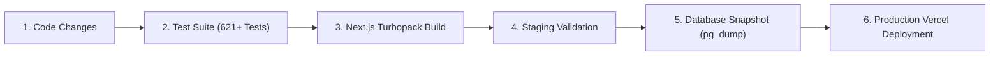

# Lets Make Brand (LMB) - Platform Maintenance Plan & Operations Runbook

## 1. Executive Summary & Infrastructure Baseline

This Maintenance Plan establishes the operational protocols, monitoring schedules, and security procedures for the **Lets Make Brand (LMB) Enterprise Partner & Brand Platform**.

### Actual Infrastructure Topology
- **Web Application:** Next.js 16+ App Router, React 19, TypeScript, Tailwind CSS hosted on **Vercel Edge Network** (`letsmakebrand.co.in`).
- **Database Engine:** **Supabase PostgreSQL 15+** (`https://nircczkfagypcxxxltso.supabase.co`) with Row Level Security (RLS) enforced across 20+ tables.
- **Authentication Service:** **Supabase Auth** (JWT, HttpOnly secure cookies, refresh token rotation).
- **Object Storage:** **Supabase Storage** (Private encrypted buckets: `kyc-documents`, `support-attachments`).
- **Financial Architecture:** Double-entry ledger (`wallet_ledger`, `wallet_balances`, `commission_transactions`) with **strict manual payout disbursement** (admin bank transfer + UTR verification).

---

## 2. Infrastructure Health & Active Status Assessment

To avoid claiming unconfigured monitoring or backups are active, here is the verified status of the operational infrastructure:

| Component | Current Actual Status | Configuration & Action Required |
| :--- | :--- | :--- |
| **Health Check API** | **Active & Verified** (`/api/health`) | Returns HTTP 200 with database latency, auth session state, and storage status. |
| **Synthetic Uptime Monitor** | **Pending External Setup** | Point external monitor (e.g. BetterStack, UptimeRobot, or Pingdom) to `https://letsmakebrand.co.in/api/health` on a 1-minute interval. |
| **Application Error Logging** | **Active & Sanitized** (`src/lib/logging/logger.ts`) | Structured JSON logging with automatic PII redaction. Currently logs to stderr / Vercel Runtime Logs. Sentry integration recommended for push alerts. |
| **Database RLS Policies** | **Active & Enforced** (20+ tables) | Default-deny security policies active. Audited via regression test suites. |
| **Audit Logging** | **Active & Immutable** (`audit_logs` table) | PostgreSQL trigger prevents updates or deletions of audit entries. |
| **Database Backups** | **Pro Plan Dependent / Manual Runbook** | Daily snapshots active on Supabase. Point-in-time recovery (PITR) requires Pro tier. Manual `pg_dump` runbook available for cold archives. |
| **Financial Reconciliation** | **Active & Tested** (`src/lib/services/reconciliation.ts`) | Invariant checker verifies ledger balances, pending withdrawals, and commission split compliance. |
| **Automated Payouts** | **Strictly Disabled by Design** | Only manual bank/UPI transfers with admin UTR confirmation are permitted. |

---

## 3. Scheduled Maintenance Cadence

### 3.1 Daily Operational Checklist
1. **Review Health Endpoint:** Confirm `/api/health` reports status `healthy` with database latency `< 150ms`.
2. **Review Server Exceptions:** Inspect Vercel Deployment Logs for unhandled exceptions or 5xx errors.
3. **Audit Pending Withdrawals:** Check the Super Admin Wallet Desk (`/dashboard/super-admin/wallet`) for pending withdrawal requests older than 24 hours.
4. **Inspect KYC Queue:** Review pending identity submissions in `/dashboard/super-admin/kyc` to prevent partner onboarding friction.
5. **Support Ticket Triage:** Ensure all critical and high-priority tickets in `/dashboard/super-admin/support` receive a staff response within 4 hours.

### 3.2 Weekly Operational Checklist
1. **Execute Automated Financial Audit:**
   Run `reconcileSingleWallet` and `runPlatformFinancialAudit` across all active vendor and partner wallets:
   - Verify: `available_balance = total_earnings - reserved_balance - total_withdrawn`.
   - Verify: No wallet holds a negative balance.
   - Verify: Total reserved balance exactly equals the sum of pending withdrawal requests.
2. **Verify Database Storage & Growth:**
   Execute storage queries in the Supabase SQL Editor:
   ```sql
   SELECT
     relname AS table_name,
     pg_size_pretty(pg_total_relation_size(relid)) AS total_size,
     pg_size_pretty(pg_relation_size(relid)) AS data_size,
     pg_size_pretty(pg_total_relation_size(relid) - pg_relation_size(relid)) AS index_size
   FROM pg_catalog.pg_statio_user_tables
   ORDER BY pg_total_relation_size(relid) DESC;
   ```
3. **Audit Admin Actions:** Inspect `audit_logs` for sensitive events:
   - Admin permission modifications (`grant_permission`, `revoke_permission`).
   - Manual wallet adjustments or commission status alterations.
   - Campaign maximum commission ceiling changes.
4. **Storage Bucket Sanitation:** Check Supabase Storage metrics to verify no unreferenced orphan files or failed uploads exceed quota limits.

### 3.3 Monthly Operational Checklist
1. **Reconcile Monthly Platform Treasury:**
   - Generate official Executive PDF and CSV Financial Reports (`/dashboard/super-admin/reports`).
   - Cross-reference total disbursements recorded in LMB against bank account transaction statements.
2. **Review Slow Queries & Index Usage:**
   ```sql
   SELECT
     schemaname,
     relname AS table_name,
     indexrelname AS index_name,
     idx_scan AS number_of_scans,
     idx_tup_read AS tuples_read,
     idx_tup_fetch AS tuples_fetched
   FROM pg_stat_user_indexes
   WHERE idx_scan = 0
   ORDER BY pg_relation_size(indexrelid) DESC;
   ```
3. **Execute Cold Database Backup (`pg_dump`):**
   Capture an encrypted offsite backup dump before the first of each month following the runbook in `docs/BACKUP_AND_RECOVERY.md`.
4. **Dependency Security Scan:**
   Run dependency compatibility checks and review for security advisories. Apply non-breaking patch updates.

---

## 4. Database Maintenance & Non-Destructive Protocols

### 4.1 Golden Rules of LMB Database Maintenance
1. **NEVER DELETE PRODUCTION DATA:** Production tables (`profiles`, `campaigns`, `leads`, `commission_transactions`, `wallet_balances`, `wallet_ledger`, `withdrawals`, `kyc_applications`, `audit_logs`) must **never** be truncated, dropped, or deleted during maintenance operations.
2. **Hard-Delete Prohibited for Financial Rows:** If a commission transaction or wallet balance requires correction, execute an authorized compensatory transaction (credit, debit, or reversal). Never execute `DELETE FROM wallet_ledger`.
3. **Pre-Migration Backups:** Before applying any future database migration, execute a manual `pg_dump` snapshot.
4. **Always Test in Staging:** Apply migrations to a non-production Supabase branch first to verify schema and RLS compatibility.

### 4.2 PostgreSQL Vacuuming & Bloat Management
Supabase manages autovacuum workers automatically. However, for high-volume lead submission periods:
```sql
-- Analyze table statistics to keep PostgreSQL query planner optimized
ANALYZE leads;
ANALYZE commission_transactions;
ANALYZE wallet_ledger;
ANALYZE audit_logs;

-- Reindex high-frequency composite indexes concurrently (zero downtime)
REINDEX INDEX CONCURRENTLY idx_leads_campaign_status;
REINDEX INDEX CONCURRENTLY idx_comm_tx_vendor_status;
REINDEX INDEX CONCURRENTLY idx_comm_tx_beneficiary;
REINDEX INDEX CONCURRENTLY idx_wallet_ledger_wallet_date;
```

---

## 5. Security Maintenance & Incident Response

### 5.1 RBAC & User Permission Verification
Quarterly review of platform privileges:
1. Verify only authorized designated personnel possess the `super_admin` role.
2. Confirm that standard `admin` accounts have `can_manage_vendor_transfers = false` unless explicit executive signoff was documented.
3. Verify that `team_leader` accounts are restricted from submitting direct earning leads.
4. Confirm database trigger `prevent_privilege_escalation` remains enabled on `profiles` and `user_roles`.

### 5.2 Incident Response Playbook

#### Level 1: Low-Impact Anomaly (Minor UI or non-financial API error)
- **Triage:** Review logger message and context in Vercel logs.
- **Resolution:** File bug report, prepare patch in development branch, execute regression suite (`pnpm test`), release patch update.
- **SLA:** Within 24 hours.

#### Level 2: Degraded Service (Database latency spike, file upload failure)
- **Triage:** Check `/api/health`. Review Supabase project metrics (Connection pooler saturation, CPU, memory).
- **Resolution:** Restart connection pooler if exhausted; clear transient locks. Notify affected users via banner notification.
- **SLA:** Within 2 hours.

#### Level 3: Critical Security / Financial Incident (Ledger mismatch, unauthorized access attempt)
1. **Immediate Quarantine:** If an unauthorized role elevation or financial inconsistency is detected:
   - Revoke the affected user session immediately via Supabase Auth admin API.
   - Lock the affected wallet status to `suspended` in `wallet_balances`.
2. **Investigation:** Query `audit_logs` for the offending IP, user agent, and operations:
   ```sql
   SELECT * FROM audit_logs
   WHERE created_at >= NOW() - INTERVAL '6 hours'
   ORDER BY created_at DESC;
   ```
3. **Ledger Audit:** Execute `reconcileSingleWallet` to inspect discrepancy details.
4. **Post-Mortem & Rectification:** Prepare a cryptographic discrepancy report. Apply authorized ledger adjustments.
5. **SLA:** Immediate response (< 15 minutes).

---

## 6. Safe Release & Deployment Protocol

All future updates must follow this strict 6-step release pipeline:



1. **Local Test Execution:** Run full test suite (`pnpm test`). All regression suites must report 100% pass rate.
2. **Local Turbopack Build:** Execute `pnpm build` to verify zero TypeScript or Next.js compilation issues.
3. **Staging Environment Deploy:** Deploy to a Vercel Preview environment linked to a staging Supabase instance.
4. **Pre-Release Cold Backup:** Capture an encrypted snapshot of the live production database.
5. **Apply Database Migrations:** Run incremental SQL migrations against production Supabase using service-role authorization.
6. **Production Cutover & Verification:** Merge PR to `master`, monitor Vercel production build, and query `/api/health` immediately.

