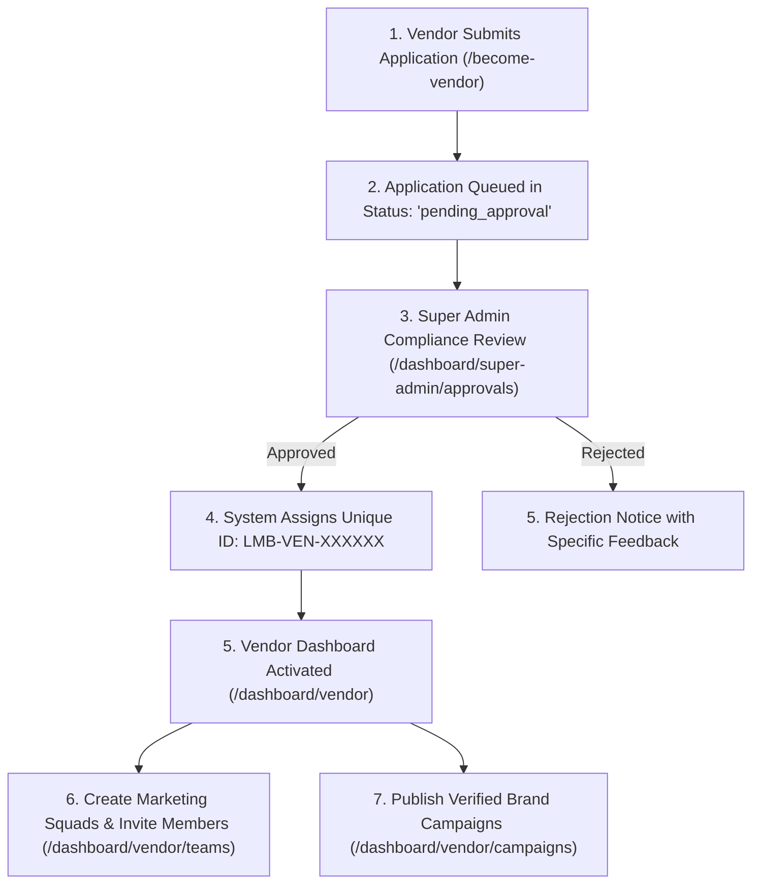
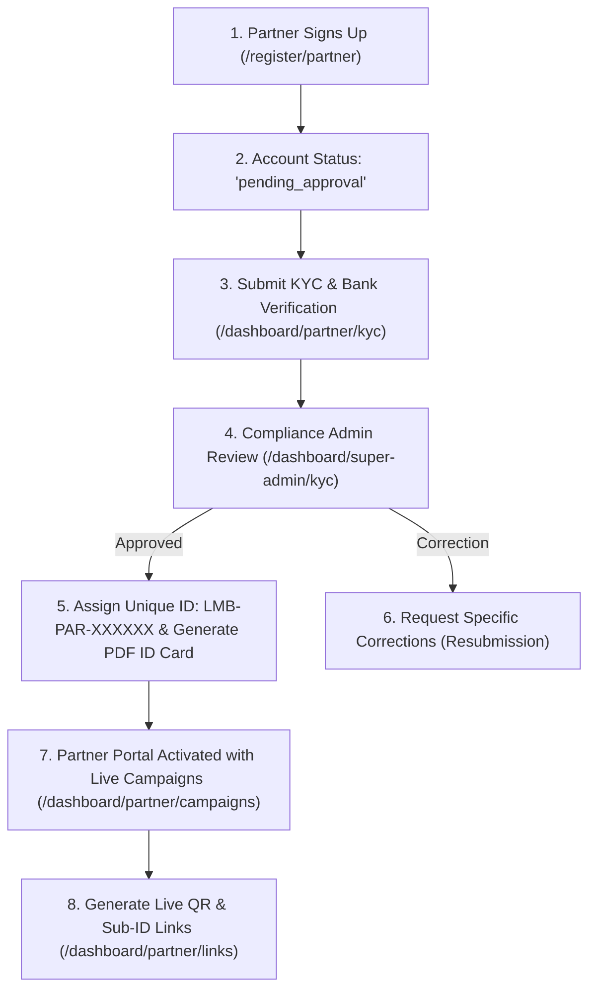
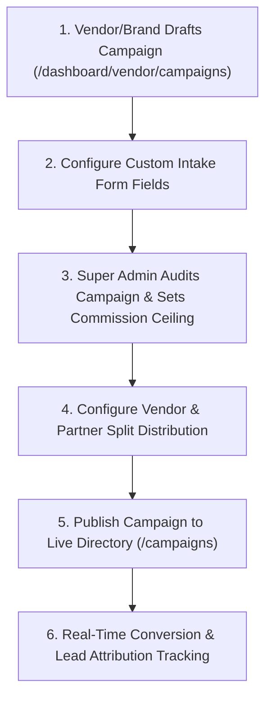

# Lets Make Brand (LMB) - Operational Onboarding Playbooks

This manual establishes the standard operating procedures (SOPs) for onboarding **Brand Vendors**, **Promotional Partners**, and **Enterprise Campaign Clients** onto the Lets Make Brand platform.

---

## Track A: Vendor Agency Onboarding Playbook

### A.1 Submission & Metadata Intake
1. **Direct Registration:** Prospective agencies navigate to `https://letsmakebrand.co.in/become-vendor` or `/register/vendor`.
2. **Required Fields Captured:**
   - Full Legal Name & Business Entity Name.
   - Corporate Email & Direct Contact Mobile Number.
   - Operating Address, City, State, and PIN Code.
   - Company Registration Type (Private Limited, LLP, Partnership, Sole Proprietorship).
   - Password conforming to enterprise complexity standards (min 8 chars, uppercase, number).
3. **Application State:** Account is created with `status = 'pending_approval'`. The user is immediately redirected to `/pending-approval`.

### A.2 Administrative Verification & ID Assignment
1. **Review Location:** Super Admin opens `/dashboard/super-admin/approvals`.
2. **Verification Checklist:**
   - Verify business authenticity and corporate email domain.
   - Confirm entity does not match any flagged or suspended accounts.
3. **Execution:** Click **Approve Vendor**.
   - Server Action: `approveVendorAction` ([src/app/dashboard/super-admin/vendors/actions.ts](file:///d:/New%20folder/src/app/dashboard/super-admin/vendors/actions.ts)).
   - **ID Generation:** Generates sequential unique Vendor ID format: **`LMB-VEN-XXXXXX`** (e.g. `LMB-VEN-000001`).
   - Account status transitions to `active`.
   - Immutable audit log event `VENDOR_APPROVED` is recorded in `audit_logs`.

### A.3 Post-Approval Vendor Operations
Once approved, the Vendor unlocks full agency governance:
- **Corporate Agency Wallet:** View lifetime override earnings in `/dashboard/vendor/wallet`.
- **Marketing Squads:** Create promotional teams and assign Team Leaders in `/dashboard/vendor/teams`.
- **Cryptographic Member Invitations:** Generate single-use secure invite links in `/dashboard/vendor/invitations`.
- **Campaign Publication:** Publish high-converting brand campaigns in `/dashboard/vendor/campaigns`.

---

## Track B: Partner Onboarding Playbook

### B.1 Fast-Track Partner Registration
1. **Public Intake:** Partners register at `https://letsmakebrand.co.in/become-partner` or `/register/partner`.
2. **Role Options:**
   - **Independent Partner:** Operates independently, receives 100% of the Super Admin configured partner commission.
   - **Squad Team Member:** Joins via a Vendor cryptographic invite link (`/invite/[token]`), operates under a Team Leader.
3. **Initial State:** Status initialized as `pending_approval`.

### B.2 KYC Compliance & Document Verification
Before promotional links can be deployed or commissions withdrawn:
1. **Partner Submission (`/dashboard/partner/kyc`):**
   - Date of Birth & Full Residential Address.
   - PAN (Permanent Account Number).
   - Bank Account Number, Account Holder Name, IFSC Code, Bank Name.
   - Supporting Identity Proofs uploaded to private bucket `kyc-documents`.
2. **Administrative Audit (`/dashboard/super-admin/kyc`):**
   - Compliance Admin audits PAN and banking details against uploaded proof.
   - Clicking **Approve** triggers `reviewKycAction`:
     - Assigns sequential unique Partner ID: **`LMB-PAR-XXXXXX`** (e.g. `LMB-PAR-000001`).
     - Vector ID Card is generated automatically with a verifiable QR code pointing to `https://letsmakebrand.co.in/verify/id/[hash]`.
     - Official Appointment / Offer Letter is generated with cryptographic issue hash.

### B.3 Lead Submission & Attribution Education
Partners access campaign promotion resources:
- **Campaign Directory:** Access verified campaigns in `/dashboard/partner/campaigns`.
- **Promotional Links & Live QR Code:** Generate customized tracking URLs with Sub-IDs (`?sub1=campaign&sub2=partner`) in `/dashboard/partner/links`.
- **Lead Submission Modal:** Leads are entered with full contact details and custom answers.
- **Deduplication Safeguards:** The anti-fraud engine checks phone, email, and IP address against existing conversions. If duplicate, the lead is flagged to protect payout integrity.

---

## Track C: Enterprise Campaign Client Launch Playbook

### C.1 Campaign Definition & Metadata Intake
1. **Campaign Header:**
   - Title, Category (`SaaS & Cloud`, `FinTech & Payments`, `E-Commerce & Fashion`, `Cyber Security`, `HealthTech`).
   - Detailed Description & Promotional Guidelines.
   - Target Audience Persona (e.g. "Retail business owners with >₹10L turnover").
   - Eligibility & Verification Criteria (e.g. "Must complete email and mobile OTP confirmation").
2. **Dynamic Form Builder:**
   - Define custom questions required for lead qualification (e.g. "Annual Revenue", "Current Software Provider", "GSTIN Number").

### C.2 Commission Ceilings & Split Versioning
1. **Super Admin Maximum Ceiling:** Super Admin sets maximum allowable commission per approved conversion (e.g. ₹500 per approved lead).
2. **Vendor Split Distribution:**
   - Vendor configures allowable distribution between agency override and partner share (e.g. ₹100 Vendor, ₹400 Partner).
   - **Validation Rule:** The sum of Vendor share + Partner share **cannot exceed** the Super Admin limit.
   - Any split modification creates a new immutable version record in `commission_splits`, ensuring previously approved leads retain their historical accrual rates.

### C.3 Campaign Deployment & Performance Monitoring
1. **Public Listing:** Verified active campaigns appear on the public directory `/campaigns` and the authenticated partner workspaces.
2. **Real-Time Analytics:** Brand Vendors and Super Admins track live lead conversion rates, duplicate discrepancies, and payout liabilities via `/dashboard/vendor/reports` and `/dashboard/super-admin/reports`.
